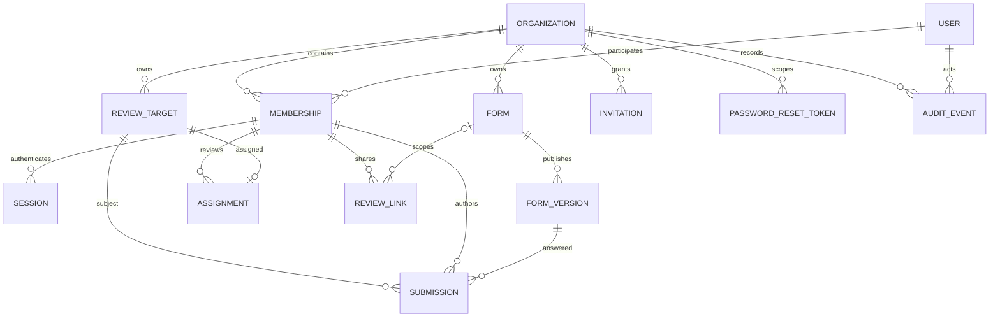
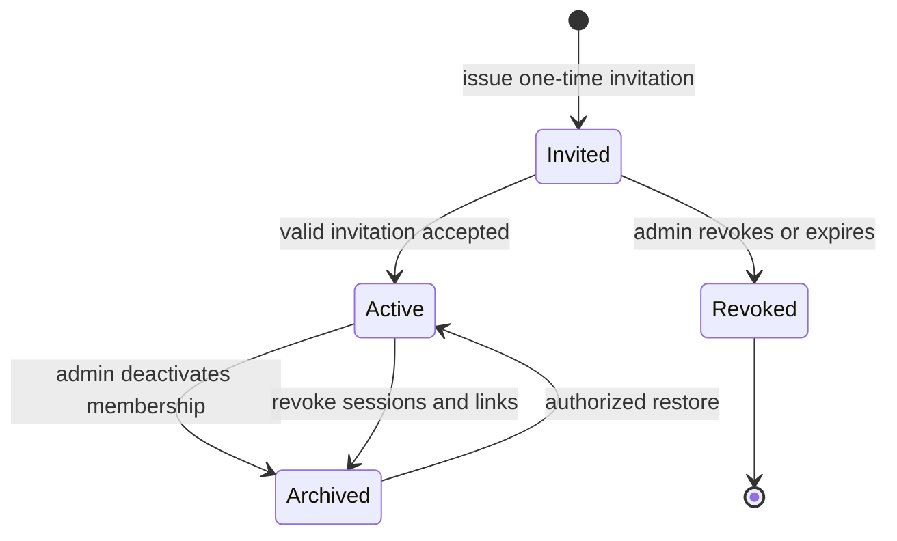
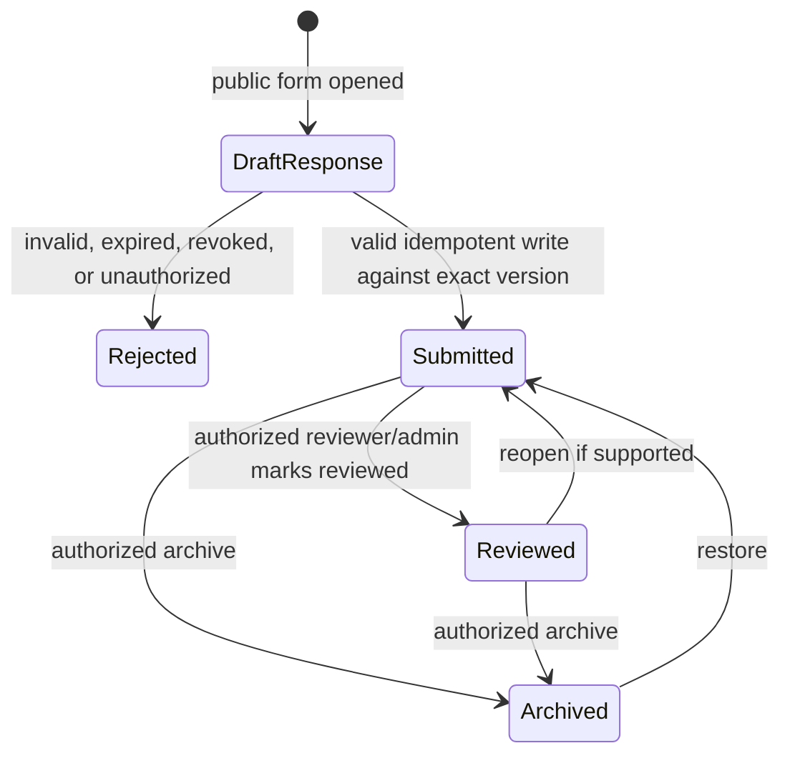

# Canonical Domain Model

This describes the replacement domain contract. Existing Prisma models are the starting data source, not a guarantee that every current relation is sufficient. Schema changes require forward-only migration and preflight.

## Relationship map

`Assignment` is the current access relationship. If assignment history is needed for audit/reconciliation, it is represented by audit events or a dedicated history entity; it must not be inferred from old submissions. All organization-scoped links must enforce organization consistency in both application queries and database constraints where supported.

## Entities and rules

| Entity | Tenant/identity | Uniqueness and lifecycle | Deletion/retention |
|---|---|---|---|
| Organization | Tenant root; owns workspace data | Unique stable slug; active unless explicitly disabled | Archive/close is a separate lifecycle; never cascade-delete production by default. |
| User | Global person identity with normalized email/display name | Unique normalized email; active/archived | Archive disables new authentication; membership and audit history remain interpretable. |
| Membership | User in one organization with Owner/Admin/Reviewer role, credentials and active/archived status | Unique `(organizationId,userId)`; credentials scoped to membership | Deactivation revokes sessions and reviewer links; do not delete if referenced by submissions/audit. |
| Session | Authentication for one user, organization and membership, plus audience/role scope | Unique token hash; expires and is revocable | Store only a cryptographic token hash; clear cookie on revoke/expiry. Admin/reviewer sessions coexist. |
| ReviewTarget | Organization-owned person being reviewed | Unique ID within org; active/archived | Archive removes from current assignment and public workflow while retaining submission history. |
| Assignment | One current reviewer membership for one target in an org | At most one per `(organizationId,targetId)`; only active same-org entities | Reassignment/unassignment changes current access; audit prior/current IDs, never delete submissions. |
| Form | Organization-owned mutable draft plus publication pointer | ID scoped to org; DRAFT/PUBLISHED/ARCHIVED | Archive prevents new links/submissions; historical versions/submissions remain. |
| FormVersion | Immutable numbered definition belonging to one form | Unique `(formId,version)`; immutable after publication | Retain while submissions or links refer to it. |
| ReviewLink | Bearer grant for an active reviewer and optional form scope | Unique token hash; active until expiry/revocation; purpose is reviewer public flow only | Store hash; cleartext reveal only at creation or by explicitly approved encrypted recovery. Revoke on membership removal. |
| Submission | Validated response for one target, reviewer, form and exact published version | Idempotency unique per organization; exact version and bounded payload | Immutable answer evidence; archive/review metadata does not erase it. Never include answers in operational logs. |
| Invitation | One-time invitation to establish a membership, with intended org/email/role | Unique token hash; expires, accepts once, or is revoked | Store hash; one-time; must not be interchangeable with reset or review tokens. |
| PasswordResetToken | One-time reset for exactly one membership | Unique hash; expires, consumes once, revokes prior reset credentials as policy defines | Store hash; membership-scoped; reset revokes that membership’s sessions only. |
| AuditEvent | Actor/action/entity/time and safe metadata in an organization | Append-only logical record with stable request/correlation reference | Never store passwords, raw tokens, full answers, or signature content. Retention policy must be defined before permanent deletion. |
| ProgressConfig | Org-level completion rule/goal | One per org; validated rule | Preserve through migration; progress is derived from active targets/submissions. |
| OrganizationTheme | Safe built-in theme selection per org | One per org; allowlisted tokens/presets | No arbitrary CSS or remote font/URL injection. |

## Invariants

1. Every read/write includes the authenticated organization ID. IDs from the browser do not establish tenant scope.
2. User identity is distinct from Membership authorization. An active role belongs to a membership, not to a global account.
3. Reviewers see only currently assigned active targets and their permitted submissions/links. Admin UI visibility is not an authorization check.
4. A target can have zero or one current active assignment. New targets and newly available unassigned targets are balanced deterministically over eligible reviewers; existing assignments stay put unless explicitly changed.
5. A reviewer, target, link and public submission must share the same organization and satisfy active/revocation/expiry rules.
6. A submission references the immutable form version it answered. Publishing creates a new version; editing draft never mutates old responses.
7. Writes that can race (assignment, publish, invitation acceptance, submit, reset) have a transaction/concurrency/idempotency rule and a stable conflict result.
8. Audit records explain access-changing writes while excluding secrets and answer payloads.
9. Archive is reversible and distinct from deletion. Permanent deletion is outside initial cutover unless an explicit approved retention policy and impact preview exist.

## Lifecycle state models

### Membership

Credentials, sessions and invitations are related but have distinct lifecycles. Re-activation does not revive expired sessions, revoked links, or old invitation tokens.

### Assignment

```mermaid
stateDiagram-v2
  [*] --> Unassigned: target created / no eligible reviewer
  Unassigned --> Assigned: least-loaded eligible reviewer selected
  Assigned --> Assigned: explicit reassignment / preserve history
  Assigned --> Unassigned: admin unassigns or reviewer becomes inactive
  Unassigned --> Archived: target archived
  Assigned --> Archived: target archived
  Archived --> Unassigned: target restored; rebalance eligible pool
```

All transitions are organization-scoped and audited. Auto-balance only fills unassigned targets; it does not silently rebalance existing targets.

### Form and publication

```mermaid
stateDiagram-v2
  [*] --> Draft
  Draft --> Draft: save draft
  Draft --> Published: validate and publish immutable version N
  Published --> Published: edit draft then publish immutable version N+1
  Draft --> Archived: archive
  Published --> Archived: archive; block new public work
  Archived --> Draft: restore for editing
```

Publication is transactional: validate draft, allocate a unique version, persist a snapshot, advance the current published pointer, and audit. A published snapshot is never edited in place.

### Submission

The persisted response is immutable. Duplicate idempotency keys with the same payload return the original receipt; reuse with a different payload returns a conflict. Archiving/reopening changes workflow metadata, not the submitted answers.

## Current-schema reconciliation notes

- The existing schema contains `Assignment`, `Membership`, `ReviewTarget`, and `Submission` with composite organization constraints for assignment, plus unique `(organizationId,targetId)`.
- Existing `Session` currently points at user, organization and membership but does not have an explicit audience field. Separate cookie names and role checks currently define audience; formal replacement contract must preserve that separation.
- Current `ReviewLink` stores `organizationId` but its schema relations should be reviewed for composite same-organization enforcement before replacement migrations.
- The schema includes `RecordStatus`, archive timestamps, and audit events but not every lifecycle transition as a dedicated event table. Migration map must preserve rows and explicitly document derived or reissued data.
- These observations require source/schema verification during implementation and are not a live database integrity report.
